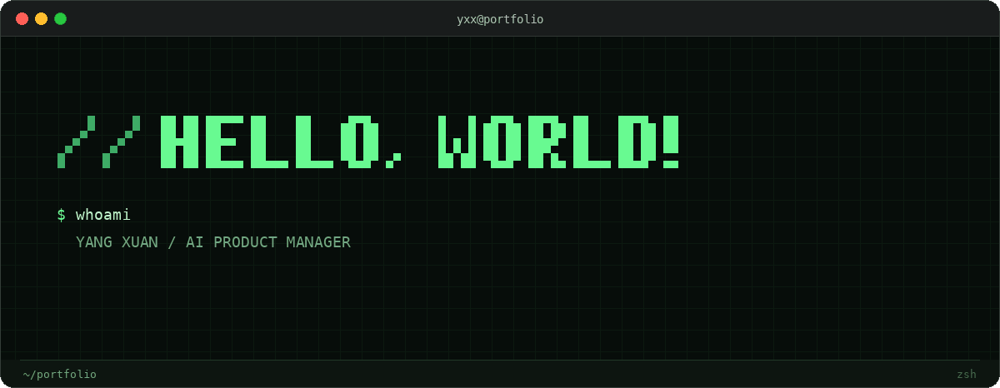
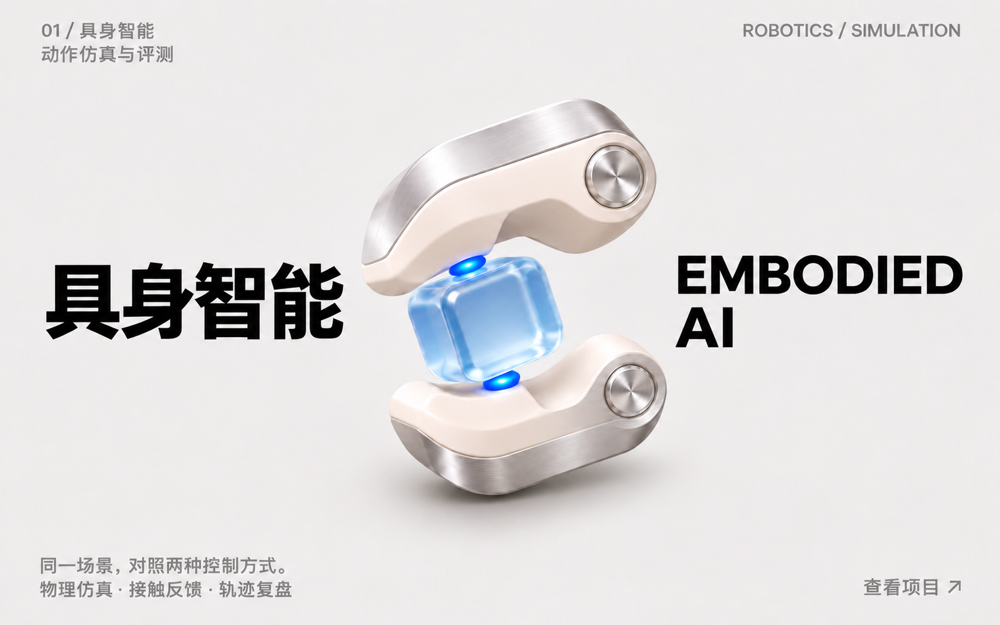
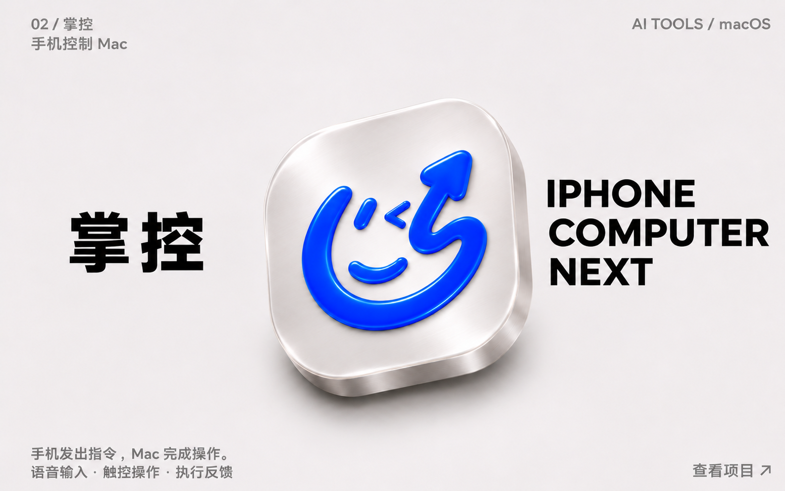
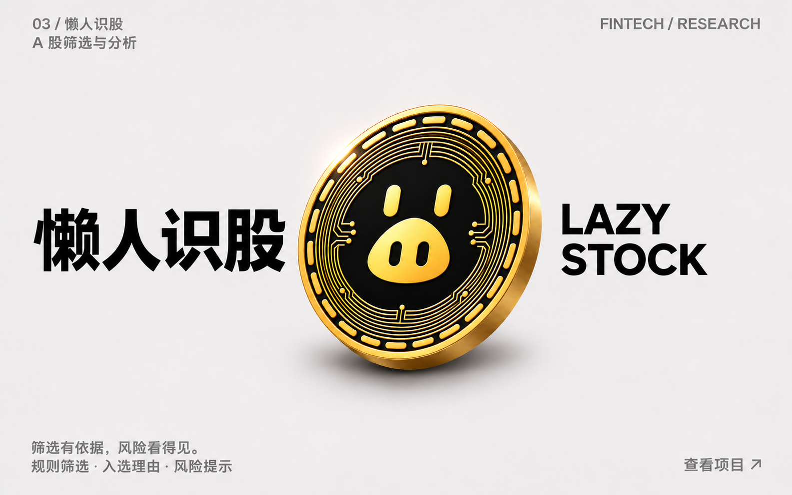
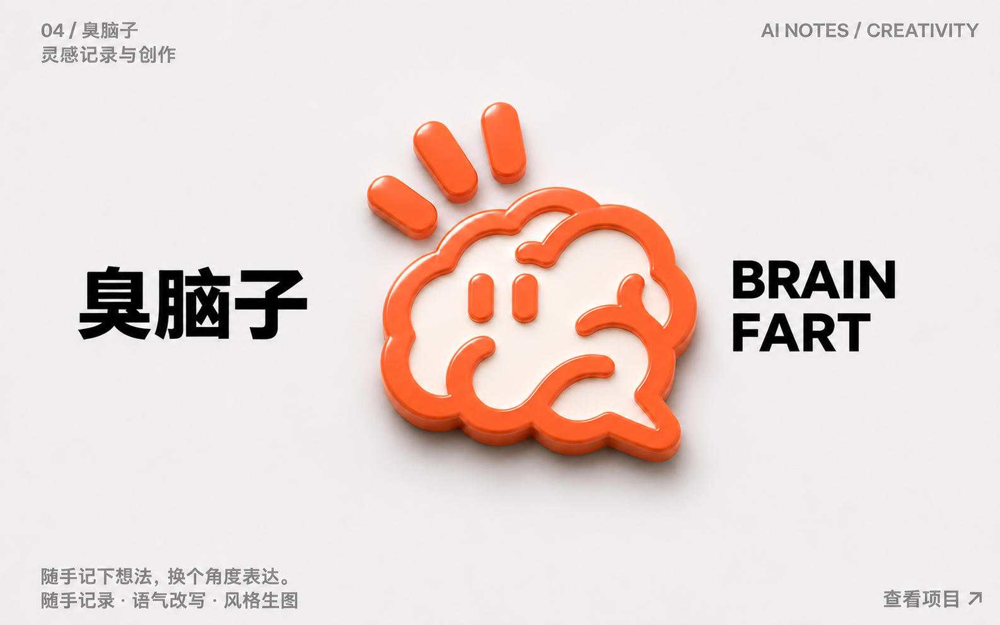

  

<h1 align="center">嗨，我是 杨轩YXX 👋</h1>

<strong>AI 产品经理 · 独立开发者 · 前设计师</strong>

<strong>把不确定的模型能力，变成可交付、可评测、可追溯的产品。</strong> 
设计是我的底色，AI 是我现在的主战场。

<code>AI Product</code> · <code>LLM / Agent</code> · <code>Evaluation</code> · <code>Data Lineage</code> · <code>AIGC</code> · <code>Embodied AI</code>

  

<h2 align="center">🧭 关于我</h2>

我关注 AI、设计，以及技术如何回应真实的人与需求。 从设计到产品，我始终保持好奇、热情、坚持与极客精神。

两年前，我从空间设计转向 AI 产品。近十年的设计与项目交付经历没有成为"过去式"，而是成了我做 AI 产品的方法论——<strong>先画清约束，再谈生成。</strong>

哪些环节必须写死成规则，哪些可以交给模型，哪些一定需要人来确认， 这条边界划得清不清，往往决定一个 AI 功能是"惊艳的 Demo"还是"能交付的系统"。

  

<h2 align="center">📝 在这里你会看到</h2>

项目复盘、AI 产品设计的思考、踩过的坑和学习记录。

我相信好的产品不是想出来的，是在真实约束里一点点磨出来的—— 所以这里不会有太多"概念解读"，更多是"当时为什么这么定"。

<table align="center">
  <tbody>
    <tr><td width="1200" align="center"><strong>🎨 设计师</strong> · 近十年设计，现在用来给 AI 产品做约束设计</td></tr>
    <tr><td width="1200" align="center"><strong>🤖 AI 产品经理</strong></td></tr>
    <tr><td width="1200" align="center"><strong>🧠 探索方向</strong>　AI × 设计 × 产品</td></tr>
    <tr><td width="1200" align="center"><strong>🛠️ 极客日常</strong></td></tr>
    <tr><td width="1200" align="center"><strong>📈 持续关注</strong> · Agent 工作流 · 数据血缘 · 具身智能评测</td></tr>
    <tr><td width="1200" align="center"><strong>🚀 欢迎</strong> · 项目合作 / 有价值的交流 / 一起把 AI 做成真东西</td></tr>
  </tbody>
</table>

🔗 <a href="https://393535466-dev.github.io/">YXX's Agent — 个人主页</a>

📮 <a href="mailto:393535466@qq.com">393535466@qq.com</a>

<!-- PROJECT-COVERS:START -->
<h2 align="center">精选项目</h2>

点击封面，查看对应项目仓库。

<table width="100%">
  <tr>
    <td width="50%" align="center" valign="top">
      
    </td>
    <td width="50%" align="center" valign="top">
      
    </td>
  </tr>
  <tr>
    <td width="50%" align="center" valign="top">
      
    </td>
    <td width="50%" align="center" valign="top">
      
    </td>
  </tr>
</table>
<!-- PROJECT-COVERS:END -->
