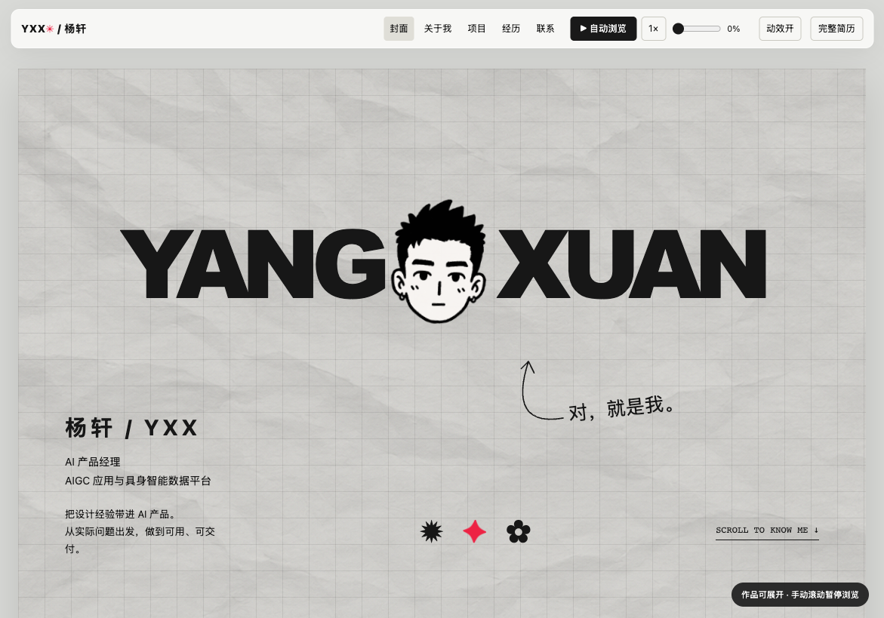

# 杨轩 / YXX

**AI 产品经理 · AIGC 应用与具身智能数据平台**

### [查看我的个人作品集 ↗](https://393535466-dev.github.io/NEW-/)

从空间设计转向 AI 产品。长期直接面对客户、方案修改与项目交付，随后将 ComfyUI、Dify 用于设计工作，参与 AIGC 应用和人体动作数据流程建设。

我关注两件事：生成结果能不能用，数据标准能不能让不同的人执行一致。

### 项目

- **人体动作数据**：梳理采集任务、动作标注规范、数据质检与失败案例，协作服务机器人训练。
- **AIGC 出图**：搭建 ComfyUI 工作流，比较图像效果，以可用初稿、返工时间和成本检查结果。
- **AI 工具与 Agent 应用**：知识库、提示词与文档模板，以及 AI 辅助页面制作和日常任务处理。

### 工具

ComfyUI · Dify · Figma · Codex · Claude · 飞书

---

**[个人作品集与完整简历](https://393535466-dev.github.io/NEW-/)** · [作品集源码](https://github.com/393535466-dev/NEW-) · [飞书简历](https://my.feishu.cn/wiki/PCh6wa1Q9i97J8kgG5Vcrl89nYg)

联系：**[393535466@qq.com](mailto:393535466@qq.com)**
